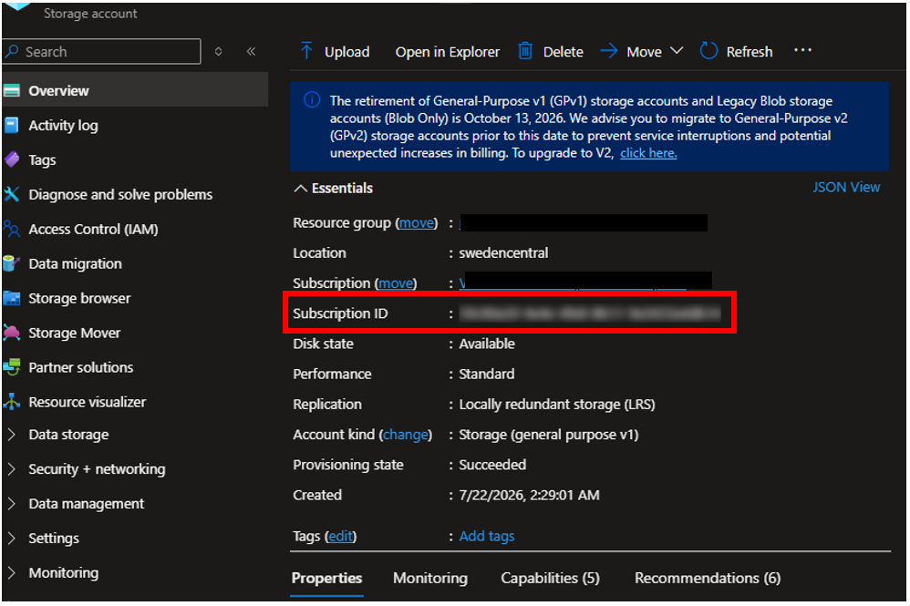
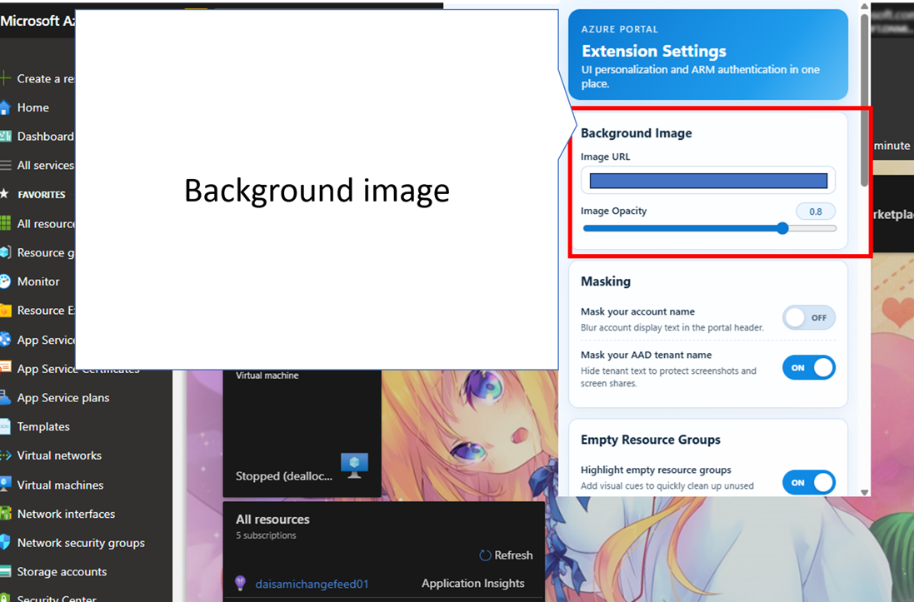
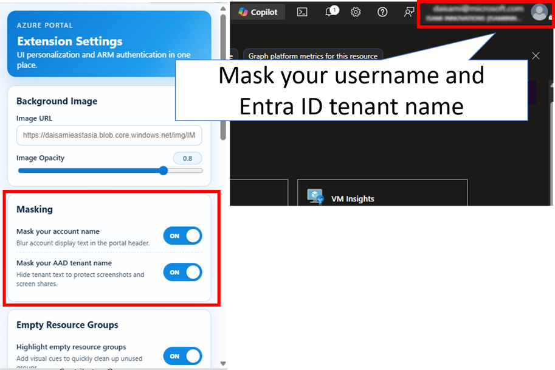
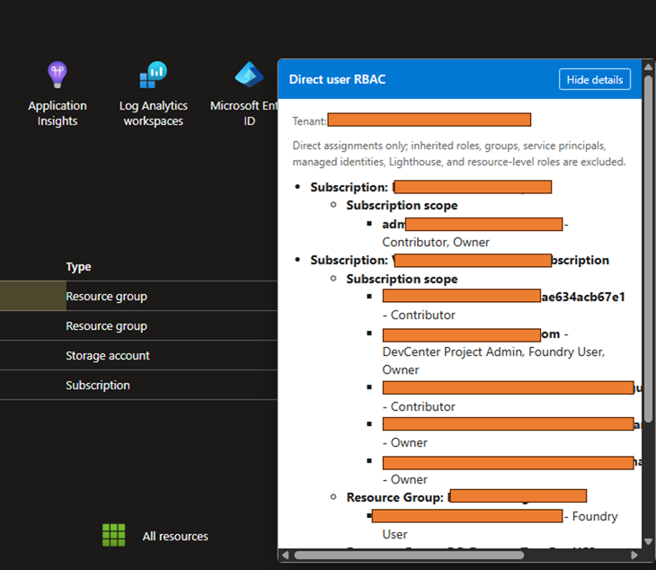
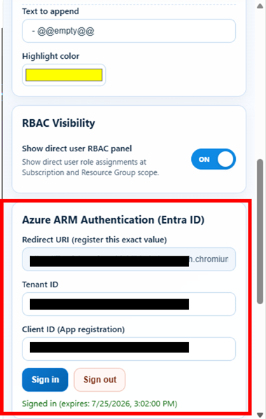
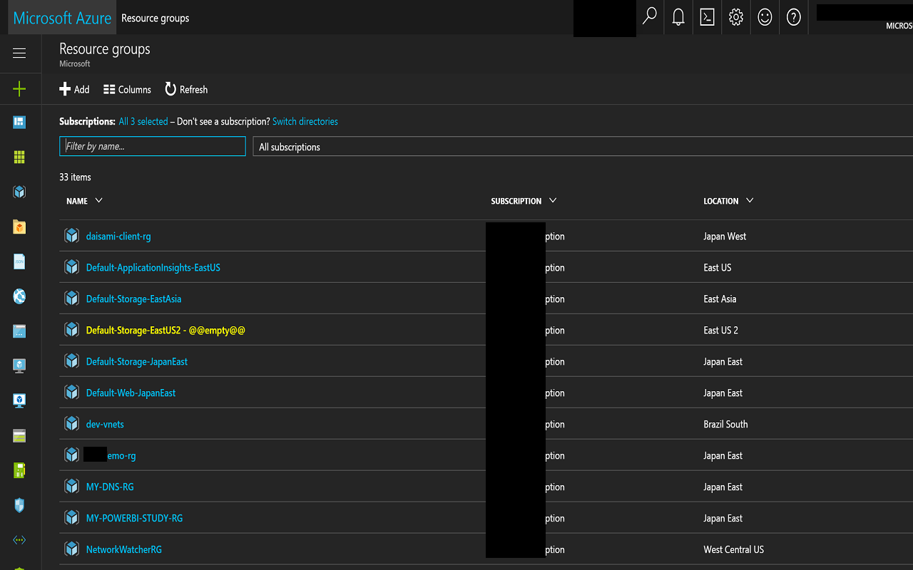
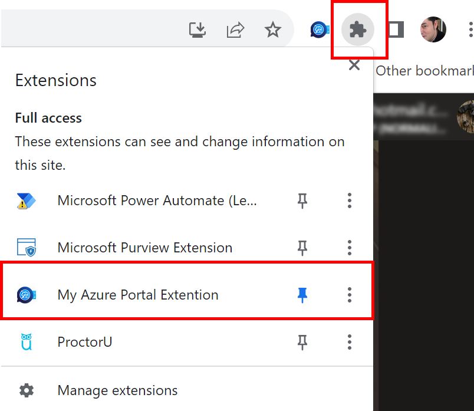

My Azure Portal Extension
============================

This extension works to enhance user experience of [Microsoft Azure Portal](https://portal.azure.com/).

## Supported browsers

- Chrome
- Edge

## How to install

- Chrome: Install from the [Chrome Web Store](https://chrome.google.com/webstore/detail/my-azure-portal-extension/jdaghfledaciocaiddjgcaamlcdhijjh).
- Edge: Install from [Microsoft Edge Add-ons](https://microsoftedge.microsoft.com/addons/detail/my-azure-portal-extension/inlofbgpcpjnokcplddkedkdlhngeldg).

## Features

No.1: Blur displayed UUID-formatted subscription IDs  throughout Azure Portal.


No.2: Configure Azure Portal background image with image url and image opacity.


No.3: Configure subscription-specific background image rules from the Options page, with JSON export and import for team sharing. Global background settings remain the fallback.

No.4: Blur username, Entra tenant throughout Azure Portal.


No.5: Show direct user RBAC list for subscription and resource groups. This feature is require to use App registration.


No.6: Entra ID sign-in with automatic token refresh for ARM API calls.


No.7: Highlight empty resource group. **This feature is require to use No.6 Entra ID sign-in and App registration**.


No.8: Show direct user RBAC assignments in a Subscription and Resource Group hierarchy. **This feature is require to use No.6 Entra ID sign-in and App registration**.

No.9: Match the browser tab icon to the current Azure Portal blade. **Azure Tab Icon** is enabled by default; previously saved preferences are preserved. Change it under **Works without sign-in features** and save settings; no extension sign-in or additional permissions are required. Icons follow visible blade headers during portal navigation. The original favicon is restored when disabled or when no supported icon is available (including Home). Inline SVGs, in-page SVG symbols, images, and CSS background images are supported; external SVG sprites are not supported. Changes apply to open portal tabs without a refresh.

### Direct user RBAC panel

The panel is disabled by default. It can be enabled or disabled from **Extension Settings > RBAC Visibility** on authenticated Azure Portal pages. The colored header can be dragged, and the details can be collapsed or expanded.

The panel displays:

- Tenant ID
- Subscription name
- Direct user role assignments at Subscription scope
- Direct user role assignments at Resource Group scope
- Role names such as `Owner`, `Contributor`, and `Reader`
- User principal names or email addresses when Microsoft Graph resolution is available

The panel intentionally excludes:

- Roles inherited from a parent scope
- Group assignments
- Service principals
- Managed identities
- Azure Lighthouse assignments
- Resource-level assignments

Only assignments whose `properties.scope` exactly matches the current Subscription or Resource Group scope are displayed. While data is being retrieved, the panel shows a loading message. If no matching assignments are found, it shows an explicit empty result message.

If user names cannot be resolved, the panel falls back to principal IDs and displays this guidance:

> Add `User.ReadBasic.All` as a Microsoft Graph delegated API permission to the App registration, grant admin consent, and sign in again.

## How to configure them
Click extension icon on your browser first, then setting popup of this Extension will be shown.



Configure this exntesion with the view as follows.


For ARM API authentication in v0.4.0, this is now a sign-in flow:

1. Enter `Tenant ID` and `Client ID`.
2. Click `save`.
3. Click `Sign in`.

No manual access-token copy/paste is required.

## Authentication for ARM API (Entra ID)

This extension now works as an independent OAuth client. It does not rely on the Azure portal session token.

### Quick start (v0.4.0)

1. Register an Entra ID App as SPA (one-time setup).
2. Set `Tenant ID` and `Client ID` in the popup.
3. Click `Sign in`.

The extension stores tokens in `chrome.storage.local` and refreshes them automatically before expiration.

### Important prerequisites

- You must create and register a Service Principal (App registration) in Entra ID before using ARM authentication in this extension.
  - MS Learn: https://learn.microsoft.com/entra/identity-platform/quickstart-register-app
- In the extension popup, copy the value shown in **Redirect URI (register this exact value)** and register that exact value in the Service Principal Redirect URI.
  - MS Learn: https://learn.microsoft.com/entra/identity-platform/how-to-add-redirect-uri
- Register the Service Principal as **Single-page application (SPA)**.
  - MS Learn: https://learn.microsoft.com/entra/identity-platform/v2-oauth2-auth-code-flow#redirect-uris-for-single-page-apps-spas

### 1. Register an Entra ID app

Create a new App registration in Entra ID and configure it as SPA.

- Platform: Single-page application (SPA)
- Redirect URI: value returned by `chrome.identity.getRedirectURL()`
  - Example: `https://<your-extension-id>.chromiumapp.org/`
- Delegated API permission: Azure Service Management `user_impersonation`
- Delegated API permission: Microsoft Graph `User.ReadBasic.All` (required for user name resolution)
- Recommended scopes in sign-in flow: `openid profile offline_access`

### RBAC tree prerequisites

The Direct user RBAC panel requires the following configuration:

- Keep the delegated Azure Service Management `user_impersonation` permission.
- Add the delegated Microsoft Graph `User.ReadBasic.All` permission to the App registration and grant admin consent.
- The signed-in user must have `Microsoft.Authorization/roleAssignments/read` on the target subscriptions. The built-in **Reader** role normally provides the required read access.
- The extension uses delegated authentication. The App registration's service principal does not need an additional Owner or Contributor role assignment for this feature.
- After changing API permissions, reload the extension and sign in again.

### 2. Configure this extension

Open the extension popup and set:

- Tenant ID
- Client ID (from App registration)

Click `save`, then click `Sign in` once.

### 3. Token lifecycle

- Access and refresh tokens are saved in `chrome.storage.local`.
- The service worker refreshes token silently before expiration using `chrome.alarms`.
- If silent refresh cannot continue (e.g. revoked consent), sign in again from the popup.

### Legacy flow (deprecated)

Older versions used manual token acquisition (for example, running `az account get-access-token` and pasting a short-lived token into the extension).

This workflow is deprecated in v0.4.0 and is no longer recommended.

### 4. Required permissions (manifest)

The extension uses the following permissions and hosts:

- `identity`, `storage`, `alarms`
- `https://login.microsoftonline.com/*`
- `https://management.azure.com/*`
- `https://graph.microsoft.com/*`

If ARM calls fail, check extension logs from the extension service worker in browser developer tools.

## Release notes

See [CHANGELOG.md](CHANGELOG.md) for the v0.1.0 to v0.4.0 summary.

Version-specific release notes are maintained in [docs/releases](docs/releases).

## Release packaging

1. Copy [secrets.local.example.json](secrets.local.example.json) to `secrets.local.json`.
2. Put the production Application Insights connection string into `secrets.local.json`.
3. Run `npm ci`.
4. Run `npm run build` to compile the TypeScript sources.
5. Run `bash scripts/package.sh` to generate `dist/my-azure-portal-extension-v<version>.zip`.

### Project layout

```text
src/                  TypeScript source of truth
extension/            Load-unpacked extension root
  manifest.json       Chrome/Edge manifest
  *.html              Popup, Options, and onboarding pages
  *.js                Generated by npm run build; do not edit directly
  css/                Extension styles
  img/                Runtime extension icons
docs/
  images/             Documentation and store screenshots
  releases/           Version-specific release notes
scripts/              Build and packaging tools
tests/                Regression tests
build/                Ignored TypeScript compiler intermediates
dist/                 Ignored release ZIP output
```

Keep package configuration, README, changelog, license, privacy policy, and the local secrets example at the repository root. Local secrets, analysis logs, and presentations remain ignored and are not moved or bundled.

For local development, run `npm run build`, then use **Load unpacked** in Chrome/Edge and select `extension/`, not the repository root. If you previously loaded the repository root, remove that development entry and load `extension/` instead. Check the displayed Redirect URI again: loading from a different path can change the development extension ID, so the App registration may need its redirect URI updated. Store-installed extensions are unaffected.

The release ZIP keeps `manifest.json` at its root (there is no enclosing `extension/` directory). The extension no longer depends on jQuery at runtime.

### Development and refactoring

- Edit TypeScript sources, not the generated JavaScript files in `extension/`. `npm run build` regenerates the service worker, content script, popup, onboarding, Options page, and shared runtime.
- `src/shared.ts` owns settings defaults, legacy storage-key mappings, runtime message names, checked Chrome storage/message helpers, and HTML escaping. Existing saved settings and message values remain compatible; current setting keys take precedence over legacy aliases.
- The shared runtime is loaded before the content script and extension-page scripts, and imported by the service worker. Generated classic scripts are scoped to avoid global-name collisions.
- Portal polling intervals and masking styles are named constants in `src/content-script.ts`. RBAC panel presentation is in `extension/css/portal.css`; API endpoints, versions, and the empty-resource-group query are centralized in `src/background.ts`.
- Run `npm run typecheck` for actual TypeScript checking and `npm test` for focused regression tests (build first).

GitHub Actions now runs the same packaging flow in CI and release jobs. The release workflow expects a repository secret named `APPINSIGHTS_CONNECTION_STRING`.


## Reference for development

- https://developer.chrome.com/extensions/webRequest
- https://github.com/otiai10/kanColleWidget/wiki/%E5%A4%96%E9%83%A8Chrome%E6%8B%A1%E5%BC%B5%E9%80%A3%E6%90%BA%E3%81%AB%E3%81%A4%E3%81%84%E3%81%A6
- http://qiita.com/mdstoy/items/9866544e37987337dc79
- http://stackoverflow.com/questions/15502691/chrome-webrequest-not-working
- https://docs.microsoft.com/en-us/rest/api/
- http://easyramble.com/chrome-storage-set-and-get.html
- https://qiita.com/nulltypo/items/4e5c494971955c767531

## Copyright
<table>
  <tr>
    <td>Copyright</td><td>Copyright (c) 2017 - Daichi Isami</td>
  </tr>
  <tr>
    <td>License</td><td>MIT License</td>
  </tr>
</table>
